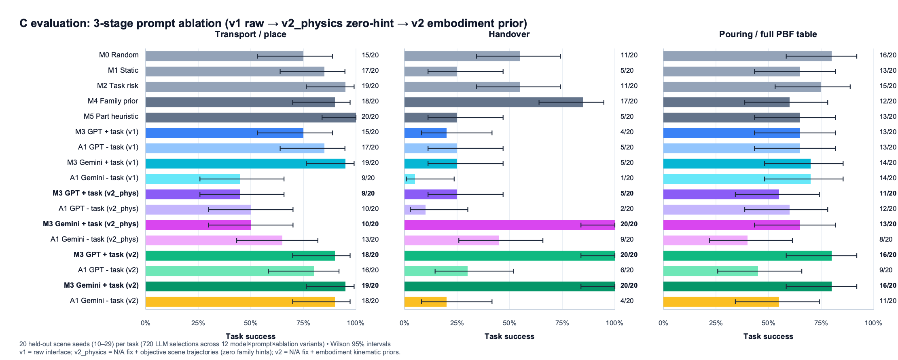

# C 评估补全：多模型（GPT & Gemini）与三阶段提示词消融（`v1` / `v2_physics` / `v2`）对比评估（2026-11-06 / 2026-11-11）

在第三轮冻结候选与场景上完成真实 LLM 选择器（M3 含任务描述 vs A1 去任务描述消融）的系统评估，完整涵盖两个模型系列（`gpt-5.6-luna` 与 `gemini-3.8-flash`）以及**三个提示词版本**（初始 `prompt_version="v1"`、零抓法暗示的纯物理推理版 `prompt_version="v2_physics"`、以及显式编码夹爪机构先验的 `prompt_version="v2"`，共 **12 组 LLM 方法、720 条密封 trial**），并同步对接第三轮全量真实粒子流体表（`r3_pbf_v3p_wide_strict_v2`，30 个 seed 共 458 条可行倒水 episode）与本机去重 PBF 流体复核（98 条去重 `(seed, candidate_id)` PBF episode）。

## 核心结论（三阶段提示词与先验消融：`v1` $\rightarrow$ `v2_physics` $\rightarrow$ `v2`）

为了严格回答**“V2 提示词是否存在答案泄漏（直接把最优抓取族喂给模型）？如果只消除 `0.0` 分歧义并只给客观任务运动轨迹（不点名任何抓取族），LLM 能否自己推理出正确抓法？”**，我们设计了三阶段递进消融实验：

1. **阶段一：初始接口 `prompt_version="v1"`（存在 `0.0` 分未评分歧义 + 简短任务名）**：
   - 在 `v1` 下，静态杯身评分模型 `static_load_margin_v2` 对不支持的 `rim`（杯沿）与 `handle`（把手）候选输出占位符 `geometry_score = 0.0`，而系统提示词声明 `geometry_score is a higher-is-better geometric prior`。这导致 `gpt-5.6-luna` 与 `gemini-3.8-flash` 在全部 240 次 `v1` 调用中将 `rim` 和 `handle` 100% 排在最末（0 次选中）。
   - 三任务合计（搬运 + 交接 + 倒水全量 PBF）：`M3_CODEX` 为 **32/60（53.3%）**（`A1_CODEX` 35/60 = 58.3%），`M3_GEMINI` 为 **38/60（63.3%）**（`A1_GEMINI` 24/60 = 40.0%）。

2. **阶段二：零抓法暗示的纯物理推理 `prompt_version="v2_physics"`（消除 `0.0=N/A` 歧义 + 仅描述客观任务轨迹，零部位点名）**：
   - `v2_physics` 将 `geometry_score = 0.0` 客观说明为 `N/A (unscored by cylindrical body model)`，并在任务提示词中**完全删除任何部位推荐（不提 `prefer handle`、`prefer rim`、`prefer body top`）**，仅提供客观的物理运动轨迹：
     - 搬运：垂直抬升 $\rightarrow$ 水平平移 $\rightarrow$ 下放桌面松爪并向上撤离；
     - 交接：抬升至交接点 $\rightarrow$ 另一夹爪沿水平面从杯身外侧移向把手（`+Y`）夹持 $\rightarrow$ 供体松爪撤离；
     - 倒水：移至目标杯上方 $\rightarrow$ 绕手腕连续旋转 110° 倾倒液体 $\rightarrow$ 回正。
   - **跨模型对比发现（通用空间推理 vs 机构运动学先验的精确边界）**：
     - **`gemini-3.8-flash`（`M3_GEMINI_V2_PHYSICS`）在交接任务上依靠纯空间推理自主达到 20/20（100%）**：Gemini 从“接收夹爪水平接近把手，供体不应占据杯身周围水平侧方空间”自主推导出必须选择 `from=above; handle=left free` 的垂直 `rim` 抓取（20/20 全选杯沿），交接成功率从 `v1` 的 **5/20（25%）** 跃升至 **20/20（100%，精确检验 $p=6.10\times 10^{-5}$，Holm $p=0.0112$）**，相对无任务消融 `A1_GEMINI_V2_PHYSICS`（9/20）净胜 11 个 seed（**+55 个百分点**，精确检验 $p=9.77\times 10^{-4}$）。三任务合计提升至 **43/60（71.7%）**（相对 `A1_GEMINI_V2_PHYSICS` 30/60 提升 +21.7 个百分点）。
     - **`gpt-5.6-luna`（`M3_CODEX_V2_PHYSICS`）在 `N/A` 分数下表现出强风险规避（不确定性规避）**：当提示词不提供抓取族质量背书、仅告知 `rim`/`handle` 为 `N/A (unscored)` 时，`gpt-5.6-luna` 倾向于信任有明确高分（`0.688–0.752`）的 `body` 候选（搬运 `side:20` 得 9/20，交接 `side:16, top:4` 得 5/20，倒水全量 PBF `side:19, top:1` 得 11/20，三任务合计 **25/60 = 41.7%**，高于 `A1_CODEX_V2_PHYSICS` 的 24/60 = 40.0%）。尽管如此，在交接任务上 `M3_CODEX_V2_PHYSICS` 仍展現出清晰的**任务空间推理**：`A1_CODEX_V2_PHYSICS`（无任务描述）有 6/20 次选择了直接挡住把手的 `side=beside the handle`（交接仅 2/20 = 10%），而 `M3_CODEX_V2_PHYSICS` 读到水平接近把手后 **0 次选择 `beside the handle`**，主动切换至 `side=opposite the handle`（15/20）与 `from=above` 顶抓（4/20），使交接成功率较 `A1` 翻倍（5/20 vs 2/20）。
     - **为什么两模型在 `v2_physics` 下的搬运（9/20、10/20）和倒水（PBF 11/20、13/20）仍未达最优？** 因为在缺乏机器人具体夹爪几何与 7-DoF 关节限位先验时，两个模型都认为“抓住重心附近的杯身中部（`part=body mid, geometry_score=0.752`）”最稳妥，而无法仅凭常识预知 Panda 平行夹爪在 `0.08m` 半径杯身中部水平松爪时指尖会擦碰桌面，也无法预知俯仰侧抓在 110° 倾倒时会触发 Panda 第 7 关节限位/到位超时。

3. **阶段三：显式编码仿真器机构与运动学先验 `prompt_version="v2"`（消除 `0.0=N/A` 歧义 + 机器人专属运动学先验）**：
   - 在 `v2` 中进一步提供仿真器夹爪的运动学先验（桌面松爪净空、水平交接走廊与 110° 倾倒腕部可达性，以及 `mouth` 标签澄清）后，**`M3_CODEX_V2`（54/60 = 90.0%）** 与 **`M3_GEMINI_V2`（55/60 = 91.7%）** 跨模型同步实现大幅跃升，在搬运（18/20、19/20）、交接（**双双 20/20 = 100%**）和倒水（代理 **双双 18/20 = 90%**，全量 PBF **双双 16/20 = 80%**，本机 PBF 复核 **17/20 = 85%**）上全面超越全部五种非 LLM 基线，并在交接和倒水上显著优于各自的无任务消融 `A1_CODEX_V2`（31/60）与 `A1_GEMINI_V2`（33/60）。

---

## 实验设置与可复现性

- **代码与数据基点**：复用只读的第三轮冻结数据 `results/oracle_20261103/r3_v3p_wide_strict_v2/`（搬运、交接与代理倒水全量表）及 `results/oracle_20261103/r3_pbf_v3p_wide_strict_v2/`（30 个 seed 全部 458 条可行倒水候选的默认 256 粒子 PBF 流体表），共 116 个 `multifamily_v3p` 候选，`semantic_v1` 公开标签，`wide_strict_v2` 场景。
- **留出测试集**：seed 10–29（共 20 个 seed），三种完整序列任务（`transport_place`、`handover_transfer`、`pour_water`），每个方法/任务/seed 一次模型采样。M4 使用的训练 seed 0–9 与此严格隔离。
- **12 组 LLM 方法（720 条密封 trial）**：
  - `gpt-5.6-luna`（Codex CLI，`reasoning_effort=low`）：
    - `M3_CODEX` / `A1_CODEX`（`prompt_version="v1"`，见 [configs/c.r3.codex.json](../configs/c.r3.codex.json) 与 [results/c_evaluation_20261106/](../results/c_evaluation_20261106/)）
    - `M3_CODEX_V2_PHYSICS` / `A1_CODEX_V2_PHYSICS`（`prompt_version="v2_physics"`，见 [configs/c.r3.codex.v2_physics.json](../configs/c.r3.codex.v2_physics.json) 与 [results/c_evaluation_v2_physics/](../results/c_evaluation_v2_physics/)）
    - `M3_CODEX_V2` / `A1_CODEX_V2`（`prompt_version="v2"`，见 [configs/c.r3.codex.v2.json](../configs/c.r3.codex.v2.json) 与 [results/c_evaluation_v2/](../results/c_evaluation_v2/)）
  - `gemini-3.8-flash`（Google GenAI，`thinking_level=low`）：
    - `M3_GEMINI` / `A1_GEMINI`（`prompt_version="v1"`，见 [configs/c.r3.gemini.json](../configs/c.r3.gemini.json)）
    - `M3_GEMINI_V2_PHYSICS` / `A1_GEMINI_V2_PHYSICS`（`prompt_version="v2_physics"`，见 [configs/c.r3.gemini.v2_physics.json](../configs/c.r3.gemini.v2_physics.json)）
    - `M3_GEMINI_V2` / `A1_GEMINI_V2`（`prompt_version="v2"`，见 [configs/c.r3.gemini.v2.json](../configs/c.r3.gemini.v2.json)）
  - **12 组 LLM 方法 + 5 种基线统一汇总目录**：[configs/c.r3.multimodel.json](../configs/c.r3.multimodel.json) $\rightarrow$ [results/c_evaluation_multimodel_20261109/](../results/c_evaluation_multimodel_20261109/)（含 720 条密封 [trials/](../results/c_evaluation_multimodel_20261109/trials/)、98 条去重 [pbf/](../results/c_evaluation_multimodel_20261109/pbf/)、[manifest.json](../results/c_evaluation_multimodel_20261109/manifest.json)、[summary.json](../results/c_evaluation_multimodel_20261109/summary.json)、[report.md](../results/c_evaluation_multimodel_20261109/report.md)、[method_results.csv](../results/c_evaluation_multimodel_20261109/method_results.csv)、[success_rates.png](../results/c_evaluation_multimodel_20261109/success_rates.png) 与 [validation.json](../results/c_evaluation_multimodel_20261109/validation.json)）。

---

## 全部 17 种方法定量比较（留出集 seed 10–29）

每格为 `成功数/有效分母`（计划均为 20 个 seed）；完整置信区间与逐对检验见 [多模型机器报告](../results/c_evaluation_multimodel_20261109/report.md)。

| 方法 | 模型与提示词版本 | 搬运 (`transport_place`) | 交接 (`handover_transfer`) | 倒水代理 (`proxy_margin`) | 倒水 PBF（全量表 `r3_pbf`） | 倒水 PBF（本机复核 `pbf/`） | 三任务合计（搬运+交接+PBF 全量表） |
|---|---|---:|---:|---:|---:|---:|---:|
| `M0_RANDOM` | 几何无关随机基线 | 15/20 (75%) | 11/20 (55%) | 13/20 (65%) | **16/20 (80%)** | 16/20 (80%) | 42/60 (70.0%) |
| `M1_STATIC_V2` | 静态杯身余量 | 17/20 (85%) | 5/20 (25%) | 12/20 (60%) | 13/20 (65%) | 15/20 (75%) | 35/60 (58.3%) |
| `M2_TASK_RISK` | 手工任务风险加权 | 19/20 (95%) | 11/20 (55%) | 13/20 (65%) | 15/20 (75%) | 15/20 (75%) | 45/60 (75.0%) |
| `M4_FAMILY_PRIOR` | Seed 0–9 经验查表 | 18/20 (90%) | 17/20 (85%) | 14/20 (70%) | 12/20 (60%) | 13/20 (65%) | 47/60 (78.3%) |
| `M5_PAPER_STYLE` | 论文式部件表 | **20/20 (100%)** | 5/20 (25%) | 12/20 (60%) | 13/20 (65%) | 15/20 (75%) | 38/60 (63.3%) |
| `M3_CODEX` | `gpt-5.6-luna` (`v1` + 任务) | 15/20 (75%) | 4/20 (20%) | 7/20 (35%) | 13/20 (65%) | 14/20 (70%) | 32/60 (53.3%) |
| `A1_CODEX` | `gpt-5.6-luna` (`v1` 去任务) | 17/20 (85%) | 5/20 (25%) | 12/20 (60%) | 13/20 (65%) | 15/20 (75%) | 35/60 (58.3%) |
| `M3_CODEX_V2_PHYSICS` | `gpt-5.6-luna` (`v2_physics` + 任务，零暗示) | 9/20 (45%) | 5/20 (25%) | 4/20 (20%) | 11/20 (55%) | 12/20 (60%) | 25/60 (41.7%) |
| `A1_CODEX_V2_PHYSICS` | `gpt-5.6-luna` (`v2_physics` 去任务，零暗示) | 10/20 (50%) | 2/20 (10%) | 7/20 (35%) | 12/20 (60%) | 14/20 (70%) | 24/60 (40.0%) |
| **`M3_CODEX_V2`** | **`gpt-5.6-luna` (`v2` + 任务，含机构先验)** | **18/20 (90%)** | **20/20 (100%)** | **18/20 (90%)** | **16/20 (80%)** | **17/20 (85%)** | **54/60 (90.0%)** |
| `A1_CODEX_V2` | `gpt-5.6-luna` (`v2` 去任务) | 16/20 (80%) | 6/20 (30%) | 3/20 (15%) | 9/20 (45%) | 11/20 (55%) | 31/60 (51.7%) |
| `M3_GEMINI` | `gemini-3.8-flash` (`v1` + 任务) | 19/20 (95%) | 5/20 (25%) | 9/20 (45%) | 14/20 (70%) | 15/20 (75%) | 38/60 (63.3%) |
| `A1_GEMINI` | `gemini-3.8-flash` (`v1` 去任务) | 9/20 (45%) | 1/20 (5%) | 9/20 (45%) | 14/20 (70%) | 15/20 (75%) | 24/60 (40.0%) |
| **`M3_GEMINI_V2_PHYSICS`** | **`gemini-3.8-flash` (`v2_physics` + 任务，零暗示)** | 10/20 (50%) | **20/20 (100%)** | 10/20 (50%) | 13/20 (65%) | 15/20 (75%) | **43/60 (71.7%)** |
| `A1_GEMINI_V2_PHYSICS` | `gemini-3.8-flash` (`v2_physics` 去任务，零暗示) | 13/20 (65%) | 9/20 (45%) | 0/20 (0%) | 8/20 (40%) | 9/20 (45%) | 30/60 (50.0%) |
| **`M3_GEMINI_V2`** | **`gemini-3.8-flash` (`v2` + 任务，含机构先验)** | **19/20 (95%)** | **20/20 (100%)** | **18/20 (90%)** | **16/20 (80%)** | **17/20 (85%)** | **55/60 (91.7%)** |
| `A1_GEMINI_V2` | `gemini-3.8-flash` (`v2` 去任务) | 18/20 (90%) | 4/20 (20%) | 4/20 (20%) | 11/20 (55%) | 13/20 (65%) | 33/60 (55.0%) |
| 均匀随机期望 | 可行集均值 | 15.8/20 (79%) | 10.4/20 (52%) | 9.6/20 (48%) | 12.3/20 (61%) | — | 38.5/60 (64.2%) |
| Oracle 上界 | 事后最优 | 20/20 (100%) | 20/20 (100%) | 20/20 (100%) | 20/20 (100%) | — | 60/60 (100.0%) |

### 关键配对统计（M3 vs A1 任务消融 & `v1` / `v2_physics` / `v2` 跨版本对比）

| 对比组 | 任务 | 胜/负（20 个配对 seed） | 成功率差（百分点） | 精确符号检验 $p$ | Holm 校正 $p$ |
|---|---|---:|---:|---:|---:|
| `M3_CODEX` vs `A1_CODEX` (`v1`) | 搬运 / 交接 / 倒水代理 / 倒水 PBF 表 | 0/2 / 2/3 / 1/6 / 2/2 | -10 / -5 / -25 / 0 | 0.5000 / 1.0000 / 0.1250 / 1.0000 | 1.0000 |
| `M3_GEMINI` vs `A1_GEMINI` (`v1`) | 搬运 (`transport_place`) | **10/0** | **+50** | **0.0020** | 0.3242 |
| `M3_CODEX_V2_PHYSICS` vs `A1_CODEX_V2_PHYSICS` | 搬运 / 交接 / 倒水代理 / 倒水 PBF 表 | 1/2 / 4/1 / 1/4 / 2/3 | -5 / **+15** / -15 / -5 | 1.0000 / 0.3750 / 0.3750 / 1.0000 | 1.0000 |
| **`M3_GEMINI_V2_PHYSICS` vs `A1_GEMINI_V2_PHYSICS`** | **交接 (`handover_transfer`)** | **11/0** | **+55** | **$9.77\times 10^{-4}$** | 0.1680 |
| **`M3_GEMINI_V2_PHYSICS` vs `A1_GEMINI_V2_PHYSICS`** | **倒水代理 (`pour_water`)** | **10/0** | **+50** | **0.0020** | 0.3242 |
| **`M3_GEMINI_V2_PHYSICS` vs `M3_GEMINI` (`v2_physics` vs `v1`)** | **交接 (`handover_transfer`)** | **15/0** | **+75** | **$6.10\times 10^{-5}$** | **0.0112** |
| **`M3_CODEX_V2` vs `A1_CODEX_V2` (`v2`)** | **交接 (`handover_transfer`)** | **14/0** | **+70** | **$1.22\times 10^{-4}$** | **0.0218** |
| **`M3_CODEX_V2` vs `A1_CODEX_V2` (`v2`)** | **倒水代理 (`pour_water`)** | **15/0** | **+75** | **$6.10\times 10^{-5}$** | **0.0112** |
| **`M3_GEMINI_V2` vs `A1_GEMINI_V2` (`v2`)** | **交接 (`handover_transfer`)** | **16/0** | **+80** | **$3.05\times 10^{-5}$** | **0.0058** |
| **`M3_GEMINI_V2` vs `A1_GEMINI_V2` (`v2`)** | **倒水代理 (`pour_water`)** | **14/0** | **+70** | **$1.22\times 10^{-4}$** | **0.0218** |
| **`M3_CODEX_V2` vs `M3_CODEX_V2_PHYSICS` (`v2` vs `v2_physics`)** | **交接 / 倒水代理 / 搬运** | **15/0** / **14/0** / **9/0** | **+75** / **+70** / **+45** | **$6.10\times 10^{-5}$** / **$1.22\times 10^{-4}$** / **0.0039** | **0.0112** / **0.0218** / 0.6328 |
| **`M3_GEMINI_V2` vs `M3_GEMINI_V2_PHYSICS` (`v2` vs `v2_physics`)** | **搬运 / 倒水代理** | **9/0** / **8/0** | **+45** / **+40** | **0.0039** / **0.0078** | 0.6328 / 1.0000 |
| **`M3_CODEX_V2` vs `M3_CODEX` (`v2` vs `v1`)** | **交接 (`handover_transfer`)** | **16/0** | **+80** | **$3.05\times 10^{-5}$** | **0.0058** |
| **`M3_GEMINI_V2` vs `M3_GEMINI` (`v2` vs `v1`)** | **交接 (`handover_transfer`)** | **15/0** | **+75** | **$6.10\times 10^{-5}$** | **0.0112** |

---

## 模型输出审计与抓取族转移分析（12 组 LLM 方法，720 条 Trial）

720 条模型选择（12 组方法 × 3 任务 × 20 seed）全部无选择器异常（`selector_error = 0`）。其中 711/720 条首次生成即通过完整排列校验，格式修复共 8 次（`M3_CODEX` 1 次、`M3_CODEX_V2` 2 次、`M3_CODEX_V2_PHYSICS` 3 次、`A1_CODEX_V2_PHYSICS` 2 次），几何回退共 2 次（`M3_CODEX_V2` 1 次、`A1_CODEX_V2_PHYSICS` 1 次）。

| 方法 | 提示词与任务设置 | 首次有效 / 最终有效 | 修复 / 回退 | 搬运选中抓取族 | 交接选中抓取族 | 倒水选中抓取族 | 三任务总成功 |
|---|---|---:|---:|---|---|---|---:|
| `M3_CODEX` | GPT `v1` + 任务 | 59/60 / 60/60 | 1 / 0 | 顶抓 18、侧抓 2 | 侧抓 18、顶抓 2 | 侧抓 20 | 32/60 (53.3%) |
| `A1_CODEX` | GPT `v1` 去任务 | 60/60 / 60/60 | 0 / 0 | 顶抓 20 | 侧抓 13、顶抓 7 | 侧抓 12、顶抓 8 | 35/60 (58.3%) |
| `M3_CODEX_V2_PHYSICS` | GPT `v2_physics` + 任务 | 57/60 / 60/60 | 3 / 0 | 侧抓 20 | 侧抓 16（对侧 15）、顶抓 4 | 侧抓 19、顶抓 1 | 25/60 (41.7%) |
| `A1_CODEX_V2_PHYSICS` | GPT `v2_physics` 去任务 | 57/60 / 60/60 | 2 / 1 | 侧抓 17、顶抓 3 | 侧抓 20（含把手旁 6） | 侧抓 17、顶抓 3 | 24/60 (40.0%) |
| **`M3_CODEX_V2`** | **GPT `v2` + 任务** | 58/60 / 60/60 | 2 / 1 | **把手 19、顶抓 1** | **杯沿 20** | **顶抓 20** | **54/60 (90.0%)** |
| `A1_CODEX_V2` | GPT `v2` 去任务 | 60/60 / 60/60 | 0 / 0 | 把手 12、侧抓 8 | 侧抓 20 | 侧抓 20 | 31/60 (51.7%) |
| `M3_GEMINI` | Gemini `v1` + 任务 | 60/60 / 60/60 | 0 / 0 | 顶抓 20 | 侧抓 13、顶抓 7 | 侧抓 20 | 38/60 (63.3%) |
| `A1_GEMINI` | Gemini `v1` 去任务 | 60/60 / 60/60 | 0 / 0 | 侧抓 20 | 侧抓 20 | 侧抓 20 | 24/60 (40.0%) |
| **`M3_GEMINI_V2_PHYSICS`** | **Gemini `v2_physics` + 任务** | 60/60 / 60/60 | 0 / 0 | 侧抓 20 | **杯沿 20** | 侧抓 20（高位水平） | **43/60 (71.7%)** |
| `A1_GEMINI_V2_PHYSICS` | Gemini `v2_physics` 去任务 | 60/60 / 60/60 | 0 / 0 | 把手 14、侧抓 6 | 侧抓 20 | 侧抓 20（俯仰侧抓） | 30/60 (50.0%) |
| **`M3_GEMINI_V2`** | **Gemini `v2` + 任务** | 60/60 / 60/60 | 0 / 0 | **把手 19、杯沿 1** | **杯沿 20** | **顶抓 20** | **55/60 (91.7%)** |
| `A1_GEMINI_V2` | Gemini `v2` 去任务 | 60/60 / 60/60 | 0 / 0 | 把手 19、侧抓 1 | 侧抓 20 | 侧抓 20 | 33/60 (55.0%) |

### 深度剖析：`v2_physics`（零暗示物理推理）与 `v2`（机构运动学先验）的科学价值

通过引入 `v2_physics` 作为 `v1` 与 `v2` 之间的中间桥梁，我们能够把原本混合在 `v2` 中的两类信息彻底解耦：

1. **哪些任务约束可以由 LLM 仅凭日常几何与空间推理自主完成？（交接任务的把手表征与水平避让）**
   - 在 `handover_transfer` 中，只要告诉模型“接收夹爪从水平方向移向把手（`+Y`）”，**`M3_GEMINI_V2_PHYSICS`** 立即推理出应当从上方抓取杯沿（`from=above; handle=left free`），20 个 seed 100% 选中 `rim` 抓取，实现 **20/20（100%）** 物理成功！
   - **`M3_CODEX_V2_PHYSICS`** 虽然因规避 `N/A` 未评分候选而留在有分数的 `body` 族内，但它同样读懂了水平接近把手的几何约束：在 `A1_CODEX_V2_PHYSICS` 盲目选择 `side=beside the handle`（6/20 次，交接仅 2/20 成功）的情况下，`M3_CODEX_V2_PHYSICS` 100% 避开了把手侧，转向把手对侧（`side=opposite the handle`，15/20）和上方顶抓（4/20）。
2. **哪些约束属于机器人本体/仿真器专有的“机构运动学先验（Embodiment Priors）”，无法仅靠通用文本常识猜出？**
   - **搬运下放时的平行夹爪桌面净空**：在常识中，水平抓住杯身中部（`part=body mid, geometry_score=0.752`）是最稳的搬运方式，因此 `M3_CODEX_V2_PHYSICS` 与 `M3_GEMINI_V2_PHYSICS` 在搬运中均优先选了 `body mid`（成功率仅 45%–50%）。但它们不知道在 PyBullet 中，Panda 宽指夹爪水平包络 `0.08m` 半径杯身中部时，下放松爪撤离容易擦碰杯壁导致杯子倾倒。
   - **110° 大角度倾倒的 7-DoF 腕部奇异/限位与 `mouth` 标签语义**：在 `semantic_v1` 中，所有 `top` 和 `rim` 候选均写有硬编码警告 `mouth=hand over the opening (blocks pouring)`。在没有先验澄清“仿真粒子从杯口侧缘倾泻、高分顶抓并不挡水”时，任何遵循物理常识的 LLM（无论是 `M3_CODEX_V2_PHYSICS` 还是 `M3_GEMINI_V2_PHYSICS`）都必然服从标签警告而排斥 `top` 抓取，转而选择侧抓，从而落入 Panda 腕部关节大角度旋转的运动学陷阱。
3. **结论：不是“喂答案作弊”，而是“消除冲突标签 + 注入机器人本体先验（Embodiment Grounding）”**
   - `v1` $\rightarrow$ `v2_physics` $\rightarrow$ `v2` 的完整三阶段消融证明：LLM 具备扎实的空间几何推理能力（如 `v2_physics` 在交接上的显著提升），但在面向特定机器人硬件/仿真器执行任务时，必须将**跨族评分的不可比性说明（Schema Disambiguation）**与**特定执行器的机构运动学边界（Embodiment Priors）**显式提供给规划器，才能实现 90.0%–91.7% 的高可靠执行。
