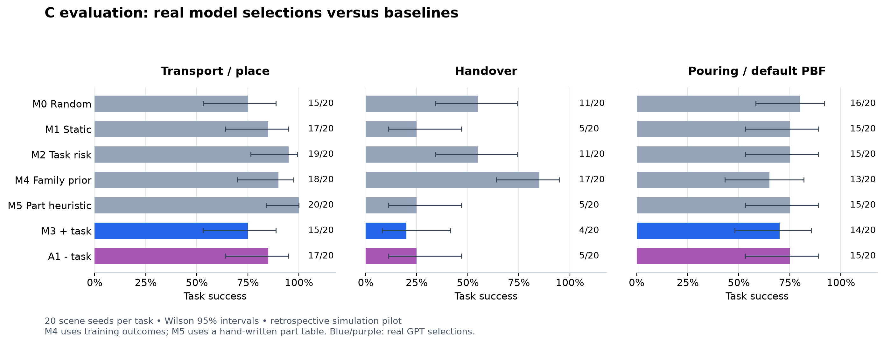

# C 评估补全（2026-11-06）

在第三轮冻结候选与场景上完成真实 M3/A1 评估。当前结果没有支持“加入任务提示就能
提高抓取成功率”：搬运 M3 为 15/20、A1 为 17/20；交接 M3 为 4/20、A1 为 5/20。
倒水代理结果同样未显示收益，最终倒水对比单独采用默认 PBF 流体复核。

## 实验设置与可复现性

- 拉取后的代码基点：`6403ba0`，此前本地为 `e4f1d1e`。
- 复用只读的第三轮数据：`results/oracle_20261103/r3_v3p_wide_strict_v2/`，
  116 个 `multifamily_v3p` 候选，`semantic_v1` 公开标签，`wide_strict_v2` 场景。
- 评价 seed 10–29，三种完整任务，每个方法/任务/seed 一次模型采样。M4 使用的
  seed 0–9 与此不重叠；这些评价 seed 已被上游分析，因此这是回顾性留出比较，
  不能称完全盲测或新的未见测试集。
- 两个真实选择器均请求 `gpt-5.6-luna`、`reasoning_effort=low`，通过现有 ChatGPT
  登录调用。M3 带任务 ID/描述，A1 移除显式任务信息，其余提示词/字段相同。
  模型 ID 为请求名称，不声称验证了服务内部快照。
- 模型只看到 `id/region/approach/gripper_width/geometry_score`，没有执行结果、
  oracle 标签、真实位姿、流体状态或失败原因。输入候选已按任务筛选，所以 A1
  的消融仅代表移除显式任务描述，不代表去掉全部任务条件信息。
- 物理成功只计数值有效的 `completed/execution_failed`；调用异常、数值异常和
  缺失结果分别排除并显示分母。置信区间为按 seed 计算的 95% Wilson 区间。
  方法间使用配对精确检验，另报告全部列出比较的 Holm 校正。

配置：[c.r3.codex.json](../configs/c.r3.codex.json)。复现命令见
[PART_C.md 第 12 节](PART_C.md#12-第三轮冻结表上的真实-m3a1-评估)。
原始回答与审计：[trials/](../results/c_evaluation_20261106/trials/)，
运行指纹：[manifest.json](../results/c_evaluation_20261106/manifest.json)，
机器统计：[summary.json](../results/c_evaluation_20261106/summary.json)。

## 方法比较

每格为成功数/20；详细置信区间和配对结果见 [机器报告](../results/c_evaluation_20261106/report.md)。

| 方法 | 搬运 | 交接 | 倒水代理 | 倒水 PBF |
|---|---:|---:|---:|---:|
| M0 随机 | 15/20 | 11/20 | 13/20 | 16/20 |
| M1 静态 v2 | 17/20 | 5/20 | 12/20 | 15/20 |
| M2 任务风险 | 19/20 | 11/20 | 13/20 | 15/20 |
| M4 族×任务查表 | 18/20 | 17/20 | 14/20 | 13/20 |
| M5 部件启发式 | 20/20 | 5/20 | 12/20 | 15/20 |
| M3 真实 GPT + 任务 | 15/20 | 4/20 | 7/20 | 14/20 |
| A1 真实 GPT 去任务 | 17/20 | 5/20 | 12/20 | 15/20 |

M3 对 A1 的配对结果：

| 任务 | M3 胜/负 | 成功率差（百分点） | 精确 p | Holm p |
|---|---:|---:|---:|---:|
| 搬运 | 0/2 | -10 | 0.5000 | 1.0000 |
| 交接 | 2/3 | -5 | 1.0000 | 1.0000 |
| 倒水代理 | 1/6 | -25 | 0.1250 | 1.0000 |
| 倒水 PBF | 2/3 | -5 | 1.0000 | 1.0000 |

搬运与交接使用完全相同的历史物理表，对每个方法选中的 ID 查表，不因方法不同重新
抽取物理结果。倒水代理是几何/刚性负载近似；PBF 是新执行的默认粒子流体，两者
单列，不合并成功率。PBF 仅执行各方法选中的候选，所以不报告其 Oracle 上界。

## 模型输出与行为

120 条选择全部取得合法最终输出，119/120 首次有效；M3 在交接 seed 18 的完整
排名校验失败一次，修复后有效。主实验共 121 次真实请求，响应缓存命中 0，几何
回退 0，选择器错误 0。开始前另做一次成功的连接试调用，不计入主实验。

| 项目 | M3 | A1 |
|---|---:|---:|
| 最终有效选择 | 60/60 | 60/60 |
| 首次有效 | 59/60 | 60/60 |
| 格式修复 | 1 | 0 |
| 几何回退 | 0 | 0 |
| 平均选择耗时（含修复） | 16.43 秒 | 14.21 秒 |
| 新请求输入 token | 737,065 | 719,464 |
| 新请求输出 token | 37,538 | 30,668 |

token 是 CLI 返回的用量字段，包含其运行上下文，不能直接解释成五字段提示词长度
或账单金额。服务端 cached-input token 与本地响应缓存命中是两件事；上述本地
响应缓存命中仍为 0。

| 任务 | M3 选中的抓取族 | A1 选中的抓取族 |
|---|---|---|
| 搬运 | 顶抓 18、侧抓 2 | 顶抓 20 |
| 交接 | 侧抓 18、顶抓 2 | 侧抓 13、顶抓 7 |
| 倒水 | 侧抓 20 | 侧抓 12、顶抓 8 |

任务提示改变了选择，但变化没有转化为已证实的收益。M3/A1 都没有选择杯沿或把手；
值得后续验证的输入问题是：现有静态模型只支持杯身，所有 8 个杯沿候选、28 个
把手候选分数都是 0，而提示词把分数描述成“越高越好”。这会混淆“不支持评分”和
“质量差”。这是由输入与选择记录支持的诊断假设，尚未通过分数消融证明因果。

交接上，M3 失败集中在碰撞（6）、掉落（4）、预抓取超时（3）和阶段物理条件（3）。
仅让出把手这一语义要求不足以保证接收夹爪完成转移。M4 的杯沿偏好能得到更好的
观察成功率，但它使用了训练场景的物理结果，不能与零样本 LLM 的信息条件混为一谈。
M5 的部件表也是手写启发式，不是真实论文方法复现或另一个 LLM 实验。

## 倒水复核

五种基线和两种 LLM 的 140 个倒水选择，去重后执行 **73 条默认 PBF episode**。
全部使用 256 粒子、8 次迭代、2 个子步；73/73 数值有效，执行调用异常 0。
状态分布：`{"completed": 68, "execution_failed": 5}`。完整记录见
[pbf/](../results/c_evaluation_20261106/pbf/)。

代理与本次 PBF 成败一致 **55/73（75.3%）**；代理成功而 PBF
失败 6 例，代理失败而 PBF 成功 12 例。代理不能替代最终倒水排名。

旧报告已有的 65 个 PBF 选择与本次全部重跑的共同条目为 65 条，其中
11 条成败改变。旧 runner 没有冻结原始环境，且候选归一化跨 Python 版本
存在微小数值差异，不能据此直接认定某一个原因。为保持方法公平，本表只使用本次
同环境、同代码下的 PBF 结果；历史值不补进本次分母。差异清单保存在
[validation.json](../results/c_evaluation_20261106/validation.json)。

## 本次完善的评估能力与验证

新增 [table_evaluation.py](../grasp_c/table_evaluation.py)，将只读历史物理表、
真实调用审计、恢复检查、数值有效分母、配对统计和新 PBF 完整 episode 接到一起。
原 oracle 入口只存模型排名，无法据此分清真实回答、修复和几何回退；本次的真实
模型结论使用新入口保存的完整调用记录。

候选文件原始字节完全匹配上游 B 来源，但本机 Python 3.12 的四元数归一化哈希与
历史值不同；用旧的顺序浮点求和可精确复现历史指纹。新读取器校验两条确定性路径
和原始文件 SHA-256，拒绝任意数据变化，不改动 A 的在线哈希规则。源表的原始运行
环境未被旧 runner 记录，这一限制在本次 manifest 中明确保留。

新增 9 项回归测试覆盖缺失/数值失败分母、配对交集、多重比较、源表身份、训练集
重叠、结果篡改、提示词隔离、修复/回退、不重复调用的恢复与实时 tuple/JSON list
的一致性。全仓库 **271 项测试通过**。完成后的真实运行恢复也成功；
PBF 恢复新增执行数为 0，193 条模型/流体原始记录不变，28 个方法/任务统计组
已独立从原始结果复算一致。

模型调用完成后修复了 C 对实时 PBF 元组/数组的比较错误。模型 trial 保留原始
manifest；流体阶段使用独立的 `pbf_manifest.json` 记录修复后的代码版本，并验证
A/B、资产、输入和环境与选择阶段完全相同。初次未能入库的批处理未计入统计，
已重新执行；没有将这类软件校验问题伪造成物理失败。

## 结论范围与下一步

现有证据不支持将 M3 宣称为优于随机或去任务描述的 A1。接口正确运行与物理任务
成功是独立问题，输出合法率很高不等于选得好。

下一轮先区分“评分不可用”与低质量，并验证公开语义标签和真实动作约束是否一致；
然后在未分析过的新 seed 上冻结比较，做分数/语义消融及多次模型采样。不要在本批
结果上调提示词后继续把 seed 10–29 称为独立测试集。本次只测试一个真实模型，
没有跨模型、真实视觉、未知杯子或真机泛化证据；`noisy_truth` 仍是仿真位姿加噪声。
